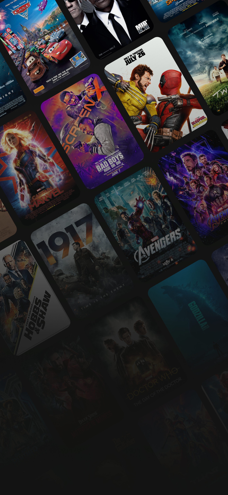

# 🎬 CineVerse - Movie Discovery & Streaming App

<p align="center">
  
</p>

<p align="center">
  <b>A modern, feature-rich movie discovery application built with Flutter, adhering strictly to Clean Architecture principles, BLoC/Cubit state management, and modern reactive programming.</b>
</p>

<p align="center">
  <a href="https://flutter.dev"></a>
  <a href="https://dart.dev"></a>
  <a href="https://bloclibrary.dev"></a>
  <a href="https://firebase.google.com"></a>
  
  
  
</p>

---

## 📑 Table of Contents
- [✨ Key Features](#-key-features)
- [📱 App Preview](#-app-preview)
- [🏛️ Architecture & Design Pattern](#️-architecture--design-pattern)
- [📂 Project Directory Structure](#-project-directory-structure)
- [🛠️ Tech Stack & Packages](#️-tech-stack--packages)
- [🚀 Getting Started](#-getting-started)
  - [Prerequisites](#prerequisites)
  - [Installation](#installation)
- [🌐 Localization](#-localization)
- [🔒 Security & Best Practices](#-security--best-practices)
- [🤝 Contributing](#-contributing)
- [👤 Author](#-author)
- [📄 License](#-license)

---

## ✨ Key Features

### 🎬 Movie Exploration & Discovery
- **Trending & Popular:** Real-time carousels and lists showcasing upcoming, popular, and top-rated movies.
- **Detailed Film View:** Comprehensive movie details including release dates, ratings, duration, genre tags, storyline synopsis, and cast lists.
- **In-App Movie Trailers:** Watch movie trailers directly in the app powered by `youtube_player_flutter`.
- **Smart Recommendations:** Context-aware suggestions based on currently selected movies.

### 🔍 Search & Filter
- **Live Search:** Instant and debounced search to query movies by title, keyword, or category.
- **Category Browsing:** Explore movies filtered by genre with smooth transitions.

### 🔐 Authentication & Profile Management
- **Multiple Auth Providers:** Email & Password authentication + Google Sign-In.
- **User Profile:** Real-time user profile synced across Firebase Authentication and Cloud Firestore.
- **Custom Avatars:** Avatar selector for user personalization.
- **Password Recovery:** Forgot password flow with email verification.

### 💖 Watchlist & Favorites
- **Cloud Synchronization:** Add or remove movies from favorites, instantly synchronized with Cloud Firestore.
- **Optimistic State Updates:** Instant UI feedback when toggling watchlist state.

### 🌍 Multi-language Support
- Full localization for **English** and **Arabic (RTL)** with seamless in-app language switching.

---

## 📱 App Preview

<p align="center">
  
  
  
</p>
<p align="center">
  
  
  
</p>

---

## 🏛️ Architecture & Design Pattern

The application follows the principles of **Clean Architecture** combined with the **BLoC / Cubit** pattern to achieve high testability, maintainability, and clean separation of concerns:

```
                      ┌────────────────────────┐
                      │   Presentation Layer   │
                      │  (UI, Screens, Cubits) │
                      └───────────┬────────────┘
                                  │ depends on
                                  ▼
                      ┌────────────────────────┐
                      │      Domain Layer      │
                      │ (Entities, Use Cases,  │
                      │ Repository Interfaces) │
                      └───────────▲────────────┘
                                  │ implemented by
                                  │
                      ┌───────────┴────────────┐
                      │       Data Layer       │
                      │ (Models, Data Sources, │
                      │  Repo Implementations) │
                      └────────────────────────┘
```

1. **Presentation Layer:**
   - **UI & Widgets:** Pure presentation components that listen to BLoC/Cubit states.
   - **View Models (Cubits):** Manages UI state, handles events, and dispatches data to the UI using `Equatable`.
2. **Domain Layer (Core Business Rules):**
   - Independent of any external packages, Flutter SDK, or database implementations.
   - Contains **Entities** and **Use Cases**.
3. **Data Layer:**
   - **Data Sources:** Remote (Dio REST API, Firebase Auth, Cloud Firestore) and Local (Flutter Secure Storage, SharedPreferences).
   - **Models:** JSON serialization & deserialization converting external payloads into Domain Entities.
   - **Repository Implementations:** Concretely coordinates between local and remote data sources.

---

## 📂 Project Directory Structure

```text
lib/
├── api/                             # API configuration, interceptors, and helpers
│   ├── api_const.dart
│   ├── api_endpoints.dart
│   ├── auth_service.dart
│   ├── bloc_observer.dart          # Global state transition logger
│   ├── dio_helper.dart             # Centralized Dio HTTP client
│   └── profile_service.dart
├── core/                            # Shared core utilities, themes, and widgets
│   ├── app_assets.dart
│   ├── app_const.dart
│   ├── app_style.dart
│   ├── provider/                   # Global providers (Language, Theme)
│   ├── routes/                     # App navigation and route generator
│   ├── theme/                      # App colors, themes, dark mode configuration
│   └── widgets/                    # Reusable widgets (CustomTextField, Buttons, etc.)
├── features/                        # Feature-driven modular structure
│   ├── auth/                       # Login, Register, Forgot Password
│   │   ├── data/                   # Data sources, models, repositories
│   │   ├── domain/                 # Entities, use cases
│   │   └── presentation/           # Screens, widgets, cubits
│   ├── movies/                     # Home, Details, Player, Search, Favorites
│   │   ├── data/
│   │   ├── domain/
│   │   └── presentation/
│   ├── onboarding/                 # Onboarding walkthrough screens
│   ├── splash/                     # Animated splash screen
│   └── tabs/                       # Main bottom navigation layout
├── l10n/                            # Localization (.arb files & generated delegates)
│   ├── app_ar.arb
│   └── app_en.arb
├── model/                           # Shared response models
└── main.dart                        # Application entry point
```

---

## 🛠️ Tech Stack & Packages

| Category | Technology / Package | Purpose |
| :--- | :--- | :--- |
| **Framework** | [Flutter](https://flutter.dev) | Cross-platform UI toolkit |
| **Language** | [Dart](https://dart.dev) | Object-oriented client-optimized language |
| **State Management** | [flutter_bloc](https://pub.dev/packages/flutter_bloc) / [cubit](https://pub.dev/packages/bloc) | Predictable, testable state transitions |
| **State Equality** | [equatable](https://pub.dev/packages/equatable) | Value equality comparison for states & events |
| **Networking** | [dio](https://pub.dev/packages/dio) | Powerful HTTP client with interceptors |
| **Backend & Cloud** | [firebase_core](https://pub.dev/packages/firebase_core) | Firebase initialization |
| **Authentication** | [firebase_auth](https://pub.dev/packages/firebase_auth) & [google_sign_in](https://pub.dev/packages/google_sign_in) | Secure email & social login |
| **Cloud Database** | [cloud_firestore](https://pub.dev/packages/cloud_firestore) | Real-time database for user favorites & watchlists |
| **Media & Video** | [youtube_player_flutter](https://pub.dev/packages/youtube_player_flutter) | In-app playback of official movie trailers |
| **Secure Storage** | [flutter_secure_storage](https://pub.dev/packages/flutter_secure_storage) | Keychain / KeyStore encrypted data storage |
| **Local Cache** | [shared_preferences](https://pub.dev/packages/shared_preferences) | Key-value store for preferences (onboarding seen) |
| **Vector Graphics** | [flutter_svg](https://pub.dev/packages/flutter_svg) | Scalable Vector Graphics rendering |
| **Asset Generation** | [flutter_gen_runner](https://pub.dev/packages/flutter_gen_runner) | Type-safe code generation for assets |
| **Localization** | [flutter_localization](https://pub.dev/packages/flutter_localization) | Official Flutter i18n & l10n |

---

## 🚀 Getting Started

### Prerequisites
- [Flutter SDK](https://docs.flutter.dev/get-started/install) (`>= 3.0.0`)
- [Dart SDK](https://dart.dev/get-dart) (`>= 3.0.0`)
- Android Studio / VS Code with Flutter extensions
- An active Firebase Project configured for Android/iOS

### Installation

1. **Clone the repository:**
   ```bash
   git clone https://github.com/shehabshawky/movie_app.git
   cd movie_app
   ```

2. **Install dependencies:**
   ```bash
   flutter pub get
   ```

3. **Generate Type-Safe Assets (Optional):**
   ```bash
   dart run build_runner build --delete-conflicting-outputs
   ```

4. **Firebase Configuration:**
   - Make sure your `google-services.json` (Android) and `GoogleService-Info.plist` (iOS) are properly placed in their respective platform directories.

5. **Run the application:**
   ```bash
   flutter run
   ```

---

## 🌐 Localization

The project supports dual-language localization out of the box:
- 🇺🇸 **English (`en`)**
- 🇪🇬 **Arabic (`ar`)** with complete Right-to-Left (RTL) layout adaptation.

Language preferences are automatically persisted, and users can toggle between languages directly from the Profile settings without restarting the application.

---

## 🔒 Security & Best Practices

- **Encrypted Storage:** User tokens and sensitive credentials are encrypted using platform-native hardware security (`KeyStore` on Android, `Keychain` on iOS) through `flutter_secure_storage`.
- **Global Error Handling:** Interceptors catch network timeouts, bad responses (401, 404, 500), and display informative, user-friendly feedback without breaking app execution.
- **SOLID Principles:** Strict adherence to Single Responsibility, Open/Closed, and Dependency Inversion throughout all domain use cases.

---

## 🤝 Contributing

Contributions, issues, and feature requests are always welcome!
1. Fork the Project.
2. Create your Feature Branch (`git checkout -b feature/AmazingFeature`).
3. Commit your Changes (`git commit -m 'feat: add some amazing feature'`).
4. Push to the Branch (`git push origin feature/AmazingFeature`).
5. Open a Pull Request.

---

## 👤 Author

**Shehab Shawky**  
- 💼 **LinkedIn:** [Shehab Shawky](https://linkedin.com/in/shehab-shawky)
- 🐙 **GitHub:** [@shehabshawky](https://github.com/shehabshawky)
- 📧 **Email:** [shehabshawky245@gmail.com](mailto:shehabshawky245@gmail.com)

---

## 📄 License

This project is licensed under the MIT License - see the [LICENSE](LICENSE) file for details.

<p align="center">
  Made with ❤️ by <a href="https://github.com/shehabshawky">Shehab Shawky</a>
</p>
